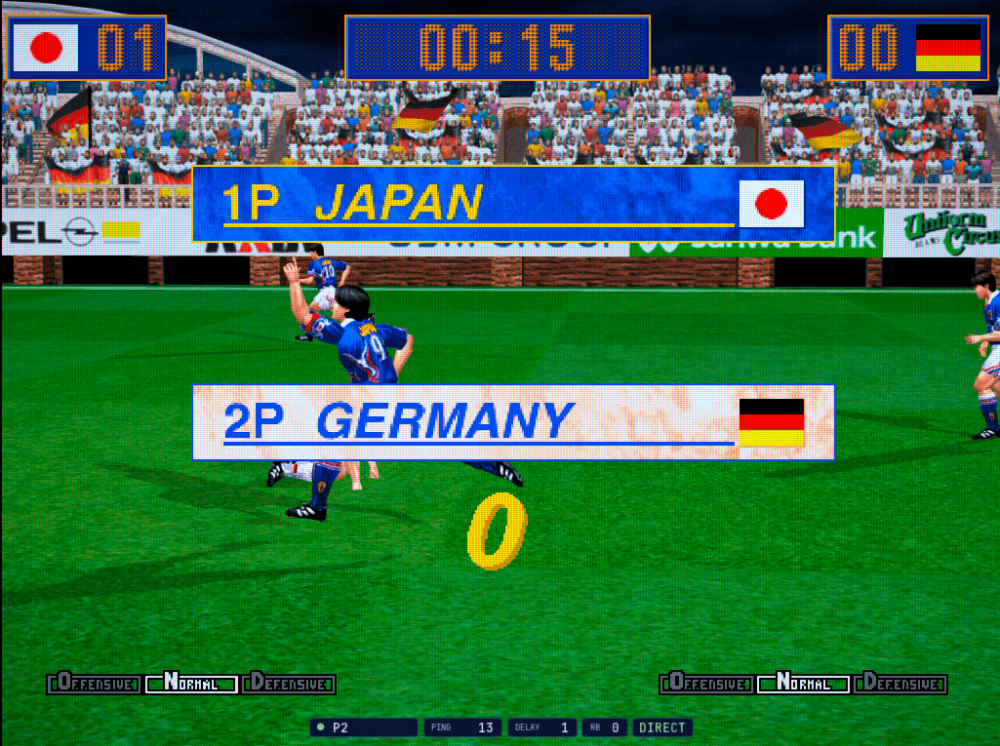
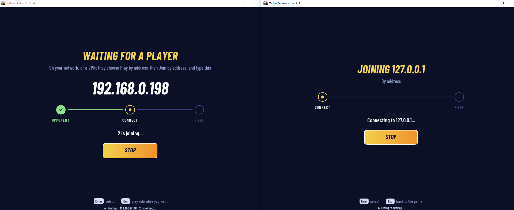
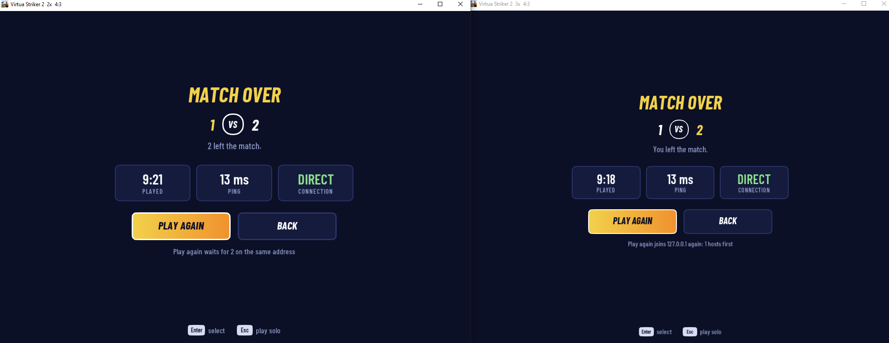
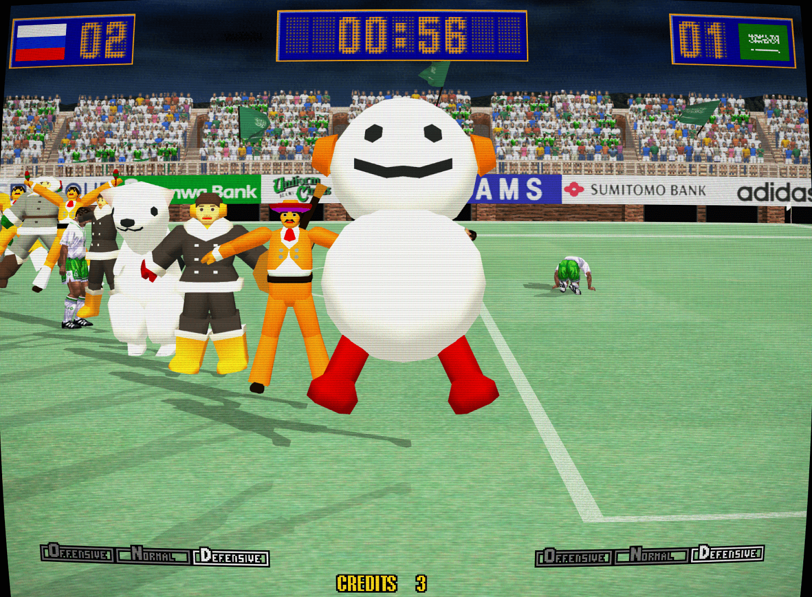

  
  <h1>Virtua Striker 2 (Step 1.5) — Native PC Static Recompilation (Windows x64)</h1>

Built upon [mr-finster/vf3-recomp](https://github.com) and [penpenlovesrei-dotcom/vf3-recomp (fv2)](https://github.com).

Native Windows x64 static recompilation of **Virtua Striker 2 (Sega Model 3 Step 1.5)** featuring HD internal resolution scaling, authentic CRT tube curvature, and low-latency P2P online multiplayer (GGPO rollback netcode).

> **Legal Disclaimer:** This release contains **NO ROMs** or copyrighted game assets. You must provide your own legally obtained MAME arcade ROM dumps to play.

## Screenshots

| | |
| :---: | :---: |
|  |  |
|  |  |

---

## 1. Required ROMs

Place the following MAME ROM archives inside the **`roms\`** folder located next to the executable:

- **`roms\vs215.zip`** — *Virtua Striker 2 (Step 1.5)* (Main set)
- **`roms\vstriker2.zip`** — *Virtua Striker 2* (Parent set, required if your `vs215.zip` is a split MAME set)

*(Note: If you use a full "non-merged" `vs215.zip`, that single file inside `roms\` is enough).*

---

## 2. How to Play

### Local / Single-Player & Couch Versus
- Double-click **`Play-vs215.bat`** to launch the game.
- **Default System Keys:**
  - **`ESC` / `F1`**: Open / close the configuration menu (`Display`, `Input`, `Online`, etc.)
  - **`5`**: Insert Coin
  - **`1`**: Player 1 Start
  - **`2`**: Player 2 Start
  - **`F3`**: Reset arcade board

*(You can remap keyboard or gamepad controls anytime under `ESC -> Input`).*

---

## 3. Online Multiplayer (1v1 P2P Rollback Netcode)

Both players must have the exact same ROM files inside their **`roms\`** folder.

### Recommended Online Settings
- **Frame Limit (`ESC -> Display -> Frame limit`):** Keep this set to **`57.53 FPS`** (original Sega Model 3 hardware refresh rate, enabled by default) or **`60 FPS`**. Both players should use the same setting—leaving it set to `Off` can cause the game speed to run slightly fast (~70 FPS) on high-refresh-rate monitors and lead to pacing hiccups online.

### Option A: Using the Launcher Scripts (`host.bat` / `guest.bat`)
1. **Player 1 (Host):**
   - Double-click **`host.bat`** to start the game in host mode (default UDP port **`7700`**).
   - Share your IP address (e.g., `100.x.y.z:7700`) with your opponent.
2. **Player 2 (Guest):**
   - Edit **`guest.bat`** with Notepad and replace the IP address after `--join` with the Host's IP (e.g., `vs2.exe "roms\vs215.zip" --join 100.x.y.z:7700`).
   - Save and double-click **`guest.bat`** to connect directly.

### Option B: From the In-Game Menu (`Play by address`)
- Press **`ESC` -> `Online` -> `Play by address`**:
  - **Host:** Select **`Host by address`** and share your displayed IP and port.
  - **Guest:** Select **`Join by address`** and enter the Host's `IP:PORT`.

*(Note: The top matchmaking code/random buttons belong to an external Virtua Fighter 3 service and are not used. Use **`host.bat` / `guest.bat`** or **`Play by address`**).*

### Network Tips (Tailscale / Port Forwarding)
- **Recommended (No Port Forwarding):** Both players can use **Tailscale**, **ZeroTier**, or **Radmin VPN** and connect using the Host's virtual IP (`100.x.y.z`).
- **Direct Public IP:** If playing without a VPN, the Host must forward **UDP port `7700`** on their router to their PC (requires a non-CG-NAT public IP).

---

## 4. Graphics, CRT Features & Recommended Settings

Open **`ESC -> Display`** to customize visuals. For the most authentic and glitch-free experience, the following settings are recommended:

- **3D Renderer:** **`Vulkan`** (recommended for best performance and visual accuracy).
- **Aspect Ratio:** **`4:3`** (recommended). The original arcade game culls 3D geometry outside the 4:3 viewport, so using Widescreen (`16:9`) can cause players or stadium objects to pop in and out near the screen edges.
- **Frame limit:** **`57.53 FPS`** (true Model 3 arcade speed) or **`60 FPS`**.
- **Resolution:** Internal 3D rendering scale (`1x` up to `8x`).
- **Screen filter / CRT effects:** Enable the **CRT filter** (`Screen filter`), **CRT colours** (Japanese arcade monitor / Sony PVM profile), and **CRT curve** (`Subtle` or `Arcade`) for authentic arcade tube visuals.

---

## 5. Building from Source (Windows x64)

1. Install **MinGW-w64 (GCC C++20)** (such as MSYS2 or `w64devkit`) and make sure `g++`, `make`, and `windres` are in your system `PATH`.
2. Place the Windows x64 development headers and libraries for **SDL3**, **FreeType**, and **zlib** inside `build/deps/win/include/` and `build/deps/win/lib/`.
3. Run **`build-host.cmd`** from the repository root to compile `build/bin/vf3.exe` (rename it to `vs2.exe` and optionally run `strip --strip-all vs2.exe`).

---

## Credits & Acknowledgments

This project is based on the Sega Model 3 static recompilation engine created by **Mr Finster** and extended for Step 2.0 by **penpenlovesrei-dotcom**:

- **Original `vf3-recomp` engine:** [mr-finster/vf3-recomp](https://github.com)
- **Step 2.0 / Fighting Vipers 2 fork:** [penpenlovesrei-dotcom/vf3-recomp (fv2 branch)](https://github.com)
- **Additional third-party components:** MAME 68000 & SCSP sound cores (BSD-3-Clause), SLJIT (BSD-2-Clause), RmlUi (MIT), SDL3 (zlib), FreeType, and Supermodel hardware documentation.

*Virtua Striker 2 is a trademark of SEGA. This is an unofficial, non-commercial fan preservation project not affiliated with or endorsed by SEGA.*
